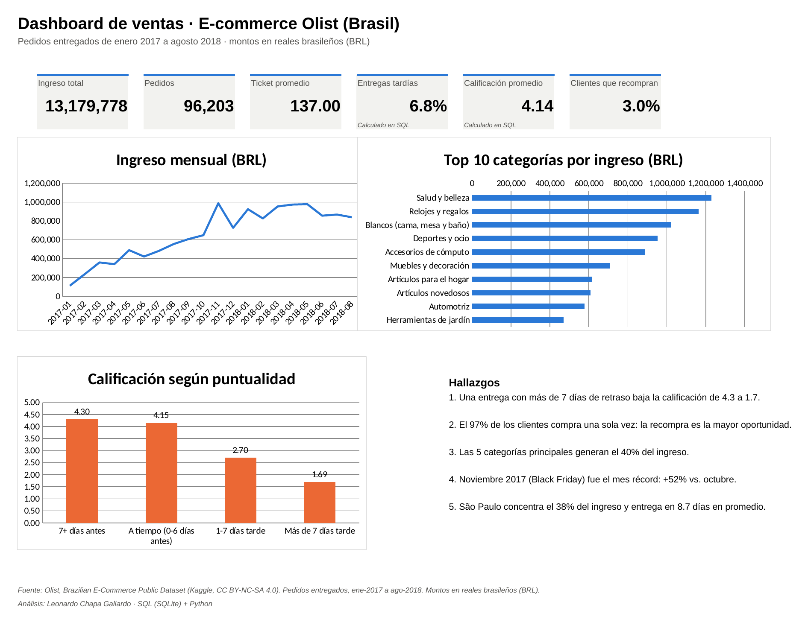

# Dashboard de ventas de e-commerce con SQL y Excel

**Leonardo Chapa Gallardo** · Estudiante de Actuaría, Facultad de Ciencias, UNAM

Proyecto personal de portafolio con datos públicos. Tomé las 7 tablas del [Brazilian E-Commerce Public Dataset de Olist](https://www.kaggle.com/datasets/olistbr/brazilian-ecommerce), con 100 mil pedidos reales y anonimizados de 2016 a 2018, las modelé en una base **SQLite**, las limpié con **SQL** y entregué un **dashboard en Excel** como el que pediría un dueño de tienda en línea.



## Preguntas de negocio que responde

1. ¿Cómo evolucionaron las ventas y qué meses destacan?
2. ¿Qué categorías generan el ingreso?
3. ¿Cuánto afecta una entrega tardía a la calificación del cliente?
4. ¿Qué estados tienen peores tiempos de entrega?
5. ¿Los clientes vuelven a comprar?

## Hallazgos

- **La puntualidad lo es todo.** Los pedidos que llegan 7 o más días antes de lo prometido tienen calificación promedio de **4.30**. Los que llegan más de 7 días tarde bajan a **1.69**, y el 80% de ellos recibe 1 o 2 estrellas.
- **El 97% de los clientes compra una sola vez.** Solo el 3% vuelve, aunque los que regresan gastan casi el doble (245 contra 138 BRL). La recompra es la mayor oportunidad del negocio.
- **Concentración:** las 5 categorías principales (salud y belleza, relojes, blancos, deportes y cómputo) generan el 40% del ingreso.
- **Noviembre de 2017 (Black Friday)** fue el mes récord, con +52% contra octubre.
- **São Paulo** concentra el 38% del ingreso y recibe en 8.7 días en promedio. Estados del norte como Roraima o Amapá esperan más de 27 días.

## Problemas en los datos y cómo los resolví

| Problema | Registros | Decisión |
|---|---:|---|
| `customer_id` cambia en cada pedido; la persona real es `customer_unique_id` | 99,441 IDs → 96,096 clientes | Medir recompra con `customer_unique_id`. Con el otro saldría 0% |
| Pedidos con 2 o 3 reseñas | 555 | Conservar la reseña más reciente con `ROW_NUMBER()` |
| Pedidos sin artículos (cancelados o no disponibles) | 775 | Fuera del análisis de ventas |
| "Entregados" sin fecha de entrega | 8 | Excluidos |
| Fechas imposibles (enviado antes de comprarse, entregado antes de enviarse) | 189 | Marcados con bandera y excluidos de los análisis de tiempos |
| Productos sin categoría | 610 | Agrupados como "Sin categoría" |
| 2 categorías que faltan en el archivo de traducción | 2 | Traducción propia al español de las 73 categorías |
| Meses incompletos en 2016 y sep/oct de 2018 | — | Análisis de ene-2017 a ago-2018 |

Ninguna fila se borra en silencio: cada exclusión está comentada en [`sql/01_crear_base.sql`](sql/01_crear_base.sql).

**Verificación:** las cifras principales (96,203 pedidos, 13.18 millones de BRL de ingreso, 97% de compra única, calificaciones por rango de entrega y participación de São Paulo) las recalculé por separado en pandas, sin SQL, y coinciden exactamente.

## Contenido

```
sql/01_crear_base.sql            Modelo limpio: tablas, banderas de calidad y vista analítica
sql/02_analisis.sql              7 consultas de negocio (CTEs, funciones de ventana, LAG, Pareto)
src/cargar.py                    Carga los CSV a SQLite, valida conteos y ejecuta el SQL
src/dashboard.py                 Construye el Excel con fórmulas y gráficas nativas
ejecutar.py                      Corre todo el proyecto
salida/dashboard_ventas_olist.xlsx  Dashboard + 6 hojas de detalle
salida/*.csv                     Resultado de cada consulta
```

El Excel no trae valores pegados: el ingreso total, el ticket promedio, el crecimiento mensual y las participaciones son **fórmulas**, y las gráficas son nativas de Excel. Si cambian las tablas, el dashboard se actualiza solo.

## Cómo reproducirlo

1. Descarga los CSV de [Kaggle](https://www.kaggle.com/datasets/olistbr/brazilian-ecommerce) y ponlos en `datos_crudos/`.
2. `pip install -r requirements.txt`
3. `python ejecutar.py`

Herramientas: SQL (SQLite), Python (pandas, openpyxl) y Excel.

## Licencia de los datos

Los datos son de Olist y se publican bajo [CC BY-NC-SA 4.0](https://creativecommons.org/licenses/by-nc-sa/4.0/). Los archivos derivados de este repositorio se comparten bajo la misma licencia.
